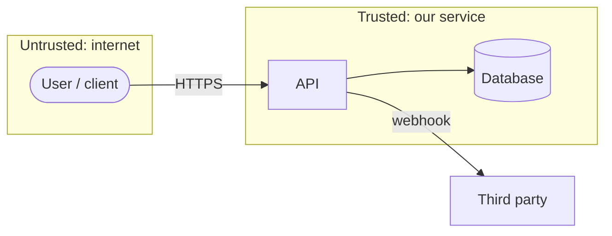

# Threat model: <system or feature>

Date: <YYYY-MM-DD> · Owner: <name> · Reviewed with: <names>

Answers the four questions of the Threat Modeling Manifesto (threatmodelingmanifesto.org):
what are we working on, what can go wrong, what are we going to do about it, did we do a good job.

## 1. What are we working on?

Data flow diagram with trust boundaries. Mark every place data crosses from less trusted to more trusted.

Assets worth protecting (data, money, availability, reputation), and who would want them.

| Asset | Sensitivity | Where it lives |
|-------|-------------|----------------|
|       |             |                |

## 2. What can go wrong? (STRIDE per element / boundary)

| # | Element or flow | STRIDE | Threat | Likelihood | Impact |
|---|-----------------|--------|--------|------------|--------|
| 1 | | S Spoofing | | | |
| 2 | | T Tampering | | | |
| 3 | | R Repudiation | | | |
| 4 | | I Information disclosure | | | |
| 5 | | D Denial of service | | | |
| 6 | | E Elevation of privilege | | | |

Also check the OWASP Top 10:2025 categories that apply, and for LLM or agent features the OWASP Top 10
for LLM Applications 2025 (prompt injection, excessive agency, improper output handling, unbounded consumption).

## 3. What are we going to do about it?

| # | Mitigation | Type (prevent / detect / respond / accept) | Task or ADR | Verified by |
|---|------------|---------------------------------------------|-------------|-------------|
|   |            |                                             |             |             |

Accepted risks need a named owner and a revisit date.

## 4. Did we do a good job?

- [ ] Every trust boundary has at least one threat considered
- [ ] Every high impact threat has a mitigation with a test or monitor
- [ ] Secrets, PII and auth flows were reviewed by someone other than the author
- [ ] Revisit trigger written down (new data type, new integration, new actor)
