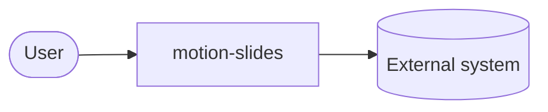
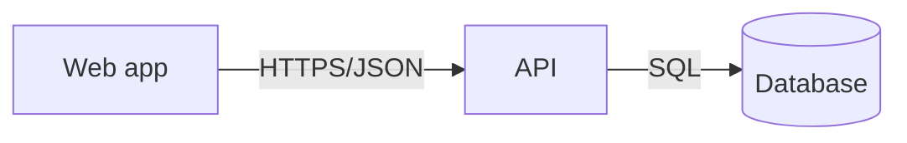

# Architecture: motion-slides

A living overview, arc42-lite with C4 diagrams. Keep each section to what a new engineer (or agent)
needs on day one. Detailed decisions live in `docs/adr/`; feature designs live in `specs/*/design.md`.

## 1. Goals and constraints

- Top three quality goals, in priority order (e.g. correctness, latency, operability):
- Hard constraints (platform, regulation, budget, team skills, deadlines):

## 2. Context (C4 level 1)

Who and what talks to the system.

## 3. Containers (C4 level 2)

The deployable or runnable pieces (apps, services, databases, queues, workers) and how they talk.

| Container | Technology | Responsibility | Owner |
|-----------|------------|----------------|-------|
|           |            |                |       |

## 4. Solution strategy

Five to ten bullets: the key ideas that shape the code (e.g. "hexagonal core, adapters at the edge",
"event-sourced orders", "server-rendered with progressive enhancement").

## 5. Building blocks

The main modules inside each container, their interfaces, and the dependency direction.

## 6. Runtime and deployment

Where it runs, how it is deployed, how it scales, how it is rolled back. Link the runbook.

## 7. Cross-cutting concepts

Auth, error handling, logging and telemetry, configuration, internationalization, caching.

## 8. Quality scenarios

Concrete, testable scenarios: "When 1,000 users submit at once, p95 stays under 500 ms."

## 9. Risks and technical debt

| Risk or debt | Impact | Plan |
|--------------|--------|------|
|              |        |      |

## 10. Glossary

The ubiquitous language. Use these exact terms in code, specs and conversations.

| Term | Meaning |
|------|---------|
|      |         |
