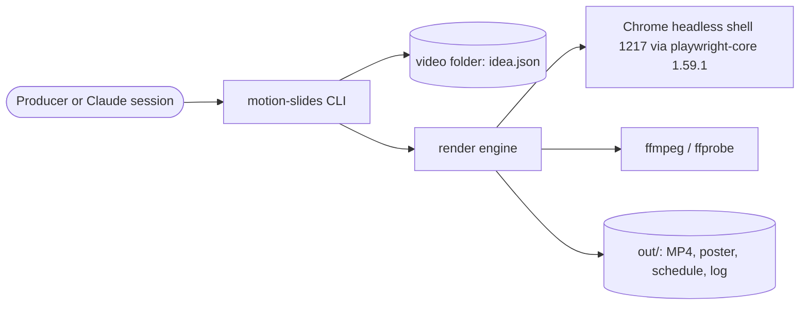

# Design: Render engine: idea to MP4

Covers build-plan Stage 0 (foundations: package, gates, CLI skeleton, CI) and Stage 1 (silent preview end to
end). Narrated timing (US3.3, US3.4) lands with 002, stills (US7) after the PoC.

## Context



Everything runs on the local machine. The only processes the engine starts are Chrome and ffmpeg. The
engine reads only `idea.json` from the video folder; the page shell, runtime, GSAP and the font come from
the installed product.

## Approach

### Toolchain: no build step

- Node 24 runs the TypeScript sources directly (built-in type stripping). Sources use erasable syntax only
  (`erasableSyntaxOnly`), import each other with `.ts` extensions (`allowImportingTsExtensions`), and
  `tsc --noEmit` is only a checker. There is no `dist/`, so tests always run against the current source
  and nothing can go stale. `package.json` has no `build` script; the `build` gate in `devbox verify` is
  skipped by `--if-present`.
- The bin is `bin/motion-slides.js`, a two-line plain JavaScript shim that imports `../src/cli/main.ts`.
- The browser runtime (`src/stage/`) is plain JavaScript ES modules with JSDoc types, served to Chrome
  as-is. A second tsc project (`tsconfig.stage.json`: DOM lib, `checkJs`, `noEmit`) type-checks it.
- GSAP is imported in the stage as `import { gsap } from '/vendor/gsap/index.js'`. `tsconfig.stage.json`
  maps that specifier through `paths` to `src/stage/types/gsap.d.ts`, a one-line re-export of the `gsap`
  package's types. No import map, no bundler, no `'unsafe-inline'`.
- `npm run typecheck` runs both tsc projects. `npm test` runs vitest. Lint and format use Biome.

### The stage page and its trust boundary

- Chrome opens `http://motion-slides.invalid/`. The page shell is the product file `src/stage/scene.html`
  (doctype, one stylesheet link, one module script). It holds no idea text and is identical for every
  video. 005 copies this same file into the video folder for people to open; the engine never reads that
  copy.
- **Static file map.** At render start the renderer builds a `Map<urlPath, {file, mime}>` by listing
  fixed roots. Each root's real path is resolved once, and every listed file's real path must stay
  under its root (no symlink escapes):

  | URL prefix | Root | Files |
  |------------|------|-------|
  | `/` | `src/stage/scene.html` | exactly that file |
  | `/runtime/` | `src/stage/` | `*.js`, `*.css` (not `types/`, not `fonts/`) |
  | `/vendor/gsap/` | real path of `node_modules/gsap/` | top-level `*.js` (the ES module build) |
  | `/fonts/` | `src/stage/fonts/` | `*.ttf` (004 adds theme fonts under assigned ids) |
  | `/assets/` | none in 001 | 004 adds theme assets under assigned ids |

  The route handler looks up `new URL(request.url).pathname` by exact string match. It never decodes,
  joins or resolves a path taken from the URL, so `..`, `%2F`, `%5C` and NUL simply miss the map. A miss
  aborts the request, records the URL, and fails the render naming it (AC8.1). MIME types come from a
  fixed extension table, and every response carries `X-Content-Type-Options: nosniff`.
- **Content Security Policy as a response header** on the document (not a meta tag in a file a user can
  edit):
  `default-src 'none'; script-src http://motion-slides.invalid/runtime/ http://motion-slides.invalid/vendor/gsap/; style-src http://motion-slides.invalid/runtime/; font-src http://motion-slides.invalid/fonts/; img-src http://motion-slides.invalid/assets/; connect-src 'none'; base-uri 'none'; form-action 'none'`.
  Inline styles set through the CSSOM (GSAP, theme variables) are not affected by `style-src`.
- **Requests the route never sees also fail the render.** The renderer listens to `requestfailed`,
  `pageerror` and console errors; the runtime forwards every `securitypolicyviolation` event through an
  exposed binding; `page.routeWebSocket(/.*/)` closes and records every WebSocket; the browser context
  sets `serviceWorkers: 'block'`. Any of these fails the render with the URL or directive.
- Defence in depth: Chrome starts with `--host-resolver-rules=MAP * ~NOTFOUND`, so no real host name
  resolves even if a request slipped past the route.
- **Data, never markup.** The renderer passes `{idea, schedule, mode}` as one JSON string with
  `page.addInitScript(fn, json)`; the init script defines a frozen `window.__MS_DATA__` from
  `JSON.parse(json)`, so a `__proto__` key in a loose object stays an ordinary property. The runtime
  builds the DOM with `createElement` and `textContent` only (AC5.5).

### Fonts (built-in neutral theme until 004)

- The product bundles **Inter Variable 4.1** (SIL OFL 1.1) as `src/stage/fonts/InterVariable.ttf`,
  with the licence beside it as `src/stage/fonts/LICENSE.txt`, both taken unmodified from the official
  release `Inter-4.1.zip` (SHA-256 `9883fdd4a49d4fb66bd8177ba6625ef9a64aa45899767dde3d36aa425756b11e`;
  `InterVariable.ttf` SHA-256 `4989b125924991b90d05b2d16e0e388c48f7d5bb8b30539bbf9c755278d0ccaf`;
  `LICENSE.txt` SHA-256 `262481e844521b326f5ecd053e59b98c8b2da78c8ee1bdbb6e8174305e54935a`). A unit
  test pins both hashes, and that pin to the upstream release is the real control on the file's
  content. The uncompressed TrueType file (880 KB) is used rather than the WOFF2 (350 KB) because the
  publish scan can read its bytes, while a compressed font is opaque and would need the user's
  approval once per file content (008 design). If the full scan still flags the font, the user adds
  its SHA-256 to their allowed-binaries file at the Stage 0 gate (T013), before T004 adds it.
- The runtime loads every declared font with
  `new FontFace(family, 'url(/fonts/<file>)', {weight: '100 900', style: 'normal'})` (without the
  weight range a variable font renders every weight at its default 400), awaits
  `face.load()`, requires `face.status === 'loaded'`, then adds it to `document.fonts`. A failed or
  missing font rejects `__ms.ready` naming the file (AC8.2). `document.fonts.ready` and
  `document.fonts.check()` are not used as evidence, because they report success for fonts that failed
  or were never declared.
- All stage text uses only that family. Neutral theme: background `#0F172A`, text `#F8FAFC`, captions
  Inter 600 at 44 px in a centred caption box 1600 px wide whose baseline sits 96 px above the bottom
  edge. 004 replaces these values with the brand theme.

### The runtime and its one timeline

- One paused GSAP timeline holds everything: scene visibility windows, per-beat caption fades (in over
  0.18 s from the beat start, out over 0.12 s from the clip end), cues at the beat start plus their
  offset, and the preview watermark.
- The timeline is `gsap.timeline({paused: true, defaults: {immediateRender: false}})`, every tween is a
  `fromTo` with explicit start and end values, and every element gets its starting state (for captions,
  opacity 0) when it is created. Without `immediateRender: false`, a caption's fade-out `fromTo` renders
  its start value (opacity 1) at build time and a fresh page shows every caption at `seek(0)`. With
  these rules the state at time `t` does not depend on which times were seeked before. `__ms.seek(t)`
  calls `tl.seek(t, false)` (callbacks run, so text set by `onUpdate` is current) and returns the
  caption state.
- A stylesheet disables CSS transitions and animations. A source-policy test bans `innerHTML`,
  `outerHTML`, `insertAdjacentHTML`, `document.write`, `eval`, `Function(`, `Math.random`, `Date.now`,
  `performance.now` and `requestAnimationFrame` in `src/stage/`, so the timeline is the only clock and
  text is never parsed as markup.
- Caption elements are laid out from the start with opacity 0. They are never `display: none`, so their
  font is loaded and their width is real. `__ms.checkCaptions()` returns
  `[{scene, beat, overflow_px}]` with `overflow_px = scrollWidth - clientWidth` for each caption
  (`white-space: nowrap`). Any overflow fails the render before capture (AC5.3).
- The preview watermark is a fixed element with the text `PREVIEW - NOT NARRATED` in the top-right
  corner, present on every frame in preview mode (AC2.2).
- `__ms.visibleText()` returns the text of every element on the stage whose computed opacity chain is
  above 0 and whose box intersects the 1920x1080 stage. In 001 that is the caption and the watermark;
  004 components add theirs automatically.

### Frames, duration and cap

- 30 fps. The schedule's natural end `D` becomes `N = ceil(D * 30 - 1e-9)` frames, and the video lasts
  exactly `N / 30` s. The tail absorbs the rounding (it grows by less than one frame). `schedule.json`
  records `frames: N` and `duration: N / 30`.
- Cap fitting targets `floor(cap * 30) / 30`, so `N / 30 <= cap` always holds.
- Shrink rule: each pause `p` (opener, lead, gap, hold, tail) becomes `min(p, max(floor, k * p))` for one
  common factor `k` in [0, 1]. A pause already at or below its floor is never lengthened. `k` is the
  largest value that fits, found by bisection to 1e-9 (deterministic). If `k = 0` still does not fit,
  the render fails as in AC6.3 before any browser starts.
- Floors: defaults from AC6.5. Gap and lead floors, and the idea's own `timing.gap`, `timing.lead` and
  every `scenes[].gap`, must be at least 0.12 s (spec amendment, see the 001 spec decisions log), so the
  previous caption's 0.12 s fade-out always ends before the next caption starts. The schedule builder
  asserts `next.fade_in.start >= prev.fade_out.end` for every consecutive pair and treats a violation as
  a bug (it throws).
- Dense scenes in 001: only the explicit `scenes[].dense` flag; their gap floor is `max(floor, 0.40)`.
  The tail floor is `max(floor, 3.0)`. 004 adds the automatic dense rule.

### Capture

- W workers, default `min(4, max(1, floor(cores / 2)))`, overridable with `--workers`. One browser, one
  page per worker, each waiting for `__ms.ready`. The first page runs `checkCaptions()` before any frame
  is taken.
- Worker `w` takes a contiguous range of frame indexes. For frame `i` it calls `seek(i / 30)`, then CDP
  `Page.captureScreenshot` (JPEG quality 92, `optimizeForSpeed`). It writes
  `<work>/frames/f%06d.jpg` (`<work>` is the run's private temp folder, below) and appends one line per
  frame to its own part file. Each frame has a 60 s stall timeout; a stall fails the render.
- After capture the part files are merged in frame order into two files:
  - `captions.jsonl`: exactly N lines,
    `{"frame": i, "t": i/30, "captions": [{"scene": "<id>", "beat": <0-based index>, "opacity": <0..1>}]}`,
    listing only captions with opacity above 0. 003 checks the line count against the MP4's `nb_frames`.
  - `stage-text.jsonl`: one line per sample time,
    `{"frame": i, "t": i/30, "scene": "<id>", "beat": <0-based>, "reason": "settle" | "landing", "text": [...]}`
    from `__ms.visibleText()`. Sample times are each beat's settle time (the later of its caption
    fade-in end and its last cue's `at + duration`, capped at its clip end, rounded to the nearest
    frame) plus any times the runtime's components register (004 counter landings). 001 is the
    producer; 003 and 004 read it.
- Determinism: an integration test captures the same idea with 1 worker and with 4 and requires every
  frame's SHA-256 to match. It also seeks fresh pages straight to arbitrary frames, and seeks backwards,
  and requires the same caption state and frame as the sequential capture.

### Encode

- One ffmpeg run: `-framerate 30 -i <work>/frames/f%06d.jpg` plus the audio input, `-frames:v N`.
  - Video: `-vf scale=out_range=tv:out_color_matrix=bt709:flags=accurate_rnd+full_chroma_int,format=yuv420p,setparams=range=tv:colorspace=bt709:color_primaries=bt709:color_trc=bt709`,
    libx264 High, CRF 18, preset medium, `-r 30`, plus the output options `-color_primaries bt709
    -color_trc bt709 -colorspace bt709 -color_range tv` as a backstop for older ffmpeg (CI runs 6.1).
    Without the scale step this ffmpeg writes a
    full-range BT.601 stream that players show with shifted brand colours; without `setparams` the
    primaries and transfer tags come out `unknown`; without the accurate-rounding flags a brand red
    drifts by 3 levels.
  - Audio: a preview uses silence of exactly `N * 1600` samples at 48 kHz stereo; a narrated render uses
    the 002 mix, which 002 makes exactly `N * 1600` samples long. AAC-LC 192k, 48 kHz, 2 channels.
  - `-movflags +faststart`. Metadata uses the standard fields only: `title` (the idea's title),
    `comment` (the disclosure) and `description` (`motion-slides timing_source=estimate` or
    `=measured`). `use_metadata_tags` is not used, because it drops the standard fields.
- After encoding, ffprobe must report `nb_frames == N`, or the render fails.

### Output sets, atomicity and the lock

- **Two output sets** (spec amendment to AC4.3): a narrated render writes `out/<name>.mp4`,
  `out/poster.jpg`, `out/schedule.json`, `out/render.log` and `build/capture/{captions,stage-text}.jsonl`.
  A preview writes the same set under `out/preview/` (`out/preview/<name>-preview.mp4` and so on) and
  `build/preview-capture/`. A preview never touches the narrated set, so a later preview can never
  replace a narrated poster or schedule that `deliver` would ship.
- **Lock**: `build/.render.lock`, created with `O_EXCL`, holding `{pid, started}`. If it exists and the
  pid is alive, the render refuses and names the pid (AC8.4). If the pid is dead, the lock is removed
  and creation retried once.
- **Run folder**: everything a run produces goes first into `build/tmp-<pid>-<random>/` (`frames/`,
  part files, the MP4, poster, schedule, captions files). Frames are always captured into this fresh
  folder, so no frame from an earlier, longer render can be encoded. After taking the lock, a render
  deletes any `build/tmp-<pid>-*` folder whose pid is no longer alive, so a run killed with `kill -9`
  does not leave 1.6 GB behind for good.
- **Publish order on success**: rename the MP4 into place first, then the poster, `schedule.json` and
  the capture files, then append the success record (including the MP4's SHA-256) to `render.log`, then
  delete the run folder (frames included, about 1.6 GB for 180 s) and release the lock. A reader can
  detect a torn publish because the newest `render.log` record names the MP4's hash.
- **On failure, stall, full disk or Ctrl-C**: abort every child (SIGTERM, then SIGKILL after 3 s, so all
  are gone within 5 s), delete the run folder, leave earlier outputs untouched, append a failure record
  to `render.log`, release the lock, exit 1. `render.log` is an append-only history of runs, so
  recording a failure never alters an earlier output (AC8.3).
- **Paths and names**: output names match `^[A-Za-z0-9_-]{1,80}$` (AC9.4); a name derived from a title
  with no usable characters falls back to `video`. `render.log` writes only paths relative to the video
  folder, never absolute paths, user names or host names. A read-only video folder fails when the run
  folder is created, before Chrome starts.

### Validation (AC1.1 to AC1.4)

- `loadIdea` reads at most 1 MB, parses JSON reporting the line and column of a syntax error (computed
  from the error position; "unexpected end" points at the end of the file), then validates with zod.
- **Strict key sets** (unknown keys rejected with the closest valid name, AC1.2) for every object the
  contract table names: the top level, `voice`, `voice.supertonic`, `voice.trim`, `audio`, `timing`,
  `timing.floors`, `scenes[]`, `beats[]` and `cues[]` (`component`, `action`, `at`, optional
  `duration`, optional `params`). `disclosure` must be a non-blank string when present (default
  "AI narration").
- Loose only where a later feature owns the inner shape and will tighten it: `theme`, `figures`,
  `banned_terms`, `signoff`, `delivery`, `audience`, `source`, `scenes[].components` and
  `cues[].params`.
- 002 enforces the binding voice values; 001 only checks types.
- Semantic rules: duplicate scene ids (both named), blank captions, blank spoken overrides, gap and lead
  at least 0.12 s, cap positive.

## Modules

| Module | Interface (public surface) | Hides | New / changed |
|--------|----------------------------|-------|---------------|
| `idea` | `loadIdea(path): Result<Idea, IdeaError[]>` | size limit, JSON position, strict zod schema, field paths, did-you-mean (Levenshtein), semantic rules | new |
| `schedule` | `buildSchedule(idea, timing: {kind: 'measured', clips} \| {kind: 'estimate'}): Result<Schedule, CapError>` | estimate (155 wpm, at least 1.0 s), AC3.1 placement, floors, shrink by bisection, frame snapping, fade times, settle times, the fade invariant | new |
| `render` | `render(folder, {preview, name?, workers?, signal}): Promise<RenderResult>` | lock, run folder, static file map and route, CSP header, Chrome lifecycle, parallel capture, part-file merge, ffmpeg encode, ffprobe frame check, poster, publish order, log, cleanup | new |
| `stage` (browser) | `window.__ms = {ready, seek(t), checkCaptions(), visibleText(), sampleTimes()}` | DOM build, font loading, caption layer, timeline, watermark | new |
| `util/proc` | `run(cmd, args, {signal, timeoutMs, input?})` | spawn with argument arrays (never a shell), SIGTERM then SIGKILL within 5 s, stall timeout | new |
| `util/fsx` | `atomicPublish`, `withLock(folder)`, `safeName(name)` | rename order, `O_EXCL` lock with stale-pid takeover, name rules | new |
| `cli` | `motion-slides render [folder] [--preview] [--name n] [--workers n] [--json]`, `--help`, `--version` | commander wiring, exit codes (0, 1, 2), stdout and stderr split | new |

## Data model

- `Idea`: the 001 contract table, validated as above.
- `Schedule` (`schedule.json`, stable key order, numbers rounded to microseconds):
  - `version`, `timing_source: measured | estimate`, `fps: 30`, `frames`, `duration`;
  - `shrink: {factor, natural, fitted} | null`;
  - `scenes[{id, start, end, beats[{start, clip, hold, end, fade_in: [s, e], fade_out: [s, e],
    settle, cues[{component, action, at}]}]}]`.
- `captions.jsonl`, `stage-text.jsonl`: as in Capture.
- Video folder: `out/`, `out/preview/`, `build/`, `build/.render.lock`, `build/tmp-*` (only during a run).

## Contracts

- CLI: `motion-slides render [folder] [--preview] [--name <name>] [--workers <n>] [--json]`,
  `motion-slides --help`, `motion-slides --version`. Exit codes 0 ok, 1 failure, 2 usage error. A
  narrated render without a voice manifest refuses with exit 1 and names the missing manifest (AC3.3);
  002 supplies the manifest.
- Readers of `schedule.json`, `captions.jsonl` and `stage-text.jsonl`: 002 (placement), 003 (sync,
  fades, on-screen text), 004 (counter landings), 006 (freshness).
- MP4 metadata: `title`, `comment`, `description` as above.

## Key flows

```mermaid
sequenceDiagram
  participant C as CLI
  participant I as idea
  participant S as schedule
  participant R as render
  participant B as Chrome
  participant F as ffmpeg
  C->>I: loadIdea (fail fast, no browser yet)
  C->>S: buildSchedule (estimate for preview; cap fit or fail)
  C->>R: render(folder, preview)
  R->>R: lock, run folder, static file map
  R->>B: launch, route, CSP header, addInitScript(data)
  B-->>R: ready (fonts loaded) and checkCaptions() empty
  loop frame ranges, W workers
    R->>B: seek(i/30) + captureScreenshot
    B-->>R: JPEG, caption state, visible text at sample times
  end
  R->>F: encode N frames + N*1600 samples into the run folder
  R->>F: ffprobe nb_frames == N
  R->>R: publish MP4, then sidecars, then log; delete run folder; unlock
```

## Cross-cutting concerns

- **Security (STRIDE):**
  - **Tampering and injection.** Idea text reaches the page as JSON data and the DOM only through
    `textContent`; the source-policy test bans markup sinks. The CSP is a response header the video
    folder cannot change, and scripts load only from the product's runtime and GSAP paths.
  - **Information disclosure.** No network: exact-match file map, every other request fails the render,
    WebSockets and service workers blocked, host resolution disabled. The log holds no absolute paths,
    user names or host names, and records the idea's hash, not its content.
  - **Elevation.** Child processes take argument arrays, never a shell. Names are restricted. The route
    serves only files listed at start-up under fixed roots after real-path checks.
  - **Denial of service.** The idea is capped at 1 MB and 200 scenes; each frame has a 60 s stall
    timeout; `ready` has a 30 s timeout.
  - **Chrome sandbox exception.** Playwright starts the headless shell with `--no-sandbox`, and this host
    cannot enable Chrome's sandbox without root (unprivileged user namespaces are restricted). Accepted
    for 001 because the page runs only product code, GSAP from npm and the bundled font, with idea text
    as data. Before 004 and 005 accept fonts and logos from requesters, those files must pass Node-side
    checks (type by magic bytes, size limit, fonts only `woff2`, `ttf`, `otf`; logos only `svg` or `png`
    shown through ``). Recorded in ADR 0003.
- **Observability.** `render.log` records per run: the product version, Chrome and ffmpeg versions, the
  idea's SHA-256, wall time per phase (validate, schedule, capture, encode, mux), frames and capture
  rate, the shrink result, the outcome and the MP4's SHA-256. Progress goes to stderr every second.
- **Performance budget.** A 180 s video renders in at most 15 minutes on this box, measured in T012.
- **Installation constraint.** Node refuses to strip types from `.ts` files under `node_modules`, so the
  product runs from a git clone (with `npm link` or a launcher script, 007), never as a package copied
  into `node_modules` by `npm i -g` from a tarball or by `npx` (ADR 0002).
- **Rollout and rollback.** A new CLI with no users. Rollback means reverting the PR.

## Testing strategy

- **Unit (vitest).** No mocks except the clock.
  - Idea validation: every rule, strict key sets per object, field paths, did-you-mean, JSON positions.
  - Schedule: AC3.1 placement, the estimate, the shrink rule (including pauses below their floor),
    frame snapping, cap target, the fade invariant on fitted schedules, dense and tail minimums, the
    overrun report, byte-identical `schedule.json` for the same input.
  - `safeName`, the lock (live pid refused, dead pid taken over), the static file map (traversal,
    `%2F`, `%5C`, NUL and symlink escapes all miss).
  - Source policy: banned sinks and clocks in `src/stage/`; no `shell: true`, `exec(` or `execSync(`
    in `src/`.
  - Font pin: the bundled font and licence match the recorded SHA-256 values.
- **Integration (real Chrome and ffmpeg, every video folder under `os.tmpdir()`, never inside the
  repository).**
  - A 5 s made-up idea renders as a preview; ffprobe asserts H.264 High, `yuv420p`, `tv` range, BT.709
    tags, 1920x1080, square pixels, 30 fps constant, `nb_frames == N`, AAC-LC 48 kHz stereo,
    durations within one frame, and the three metadata fields.
  - Tricky text (`$1,000 $& $1 $\` <b>bold</b> &amp;`, `<script>window.__pwned=1</script>` and
    ``): each caption's `textContent` equals its input, it has no
    child elements, `window.__pwned` stays undefined, and no CSP violation is reported.
  - A runtime that requests an unlisted URL, a font that fails to load, and a WebSocket each fail the
    render naming the URL or file.
  - The watermark text is in `visibleText()` at the first, middle and last frame of a preview.
  - A caption at weight 600 measures wider than the same caption at 400 (the variable font's weight
    range is honoured).
  - 1 worker versus 4 workers give identical frame hashes.
  - Abort mid-capture and a forced ffmpeg failure leave no MP4 under the final name, earlier outputs
    unchanged, no run folder, and a failure record in `render.log`.
  - A second render on the same folder is refused naming the pid.
  - Rendering two different ideas leaves `src/`, `bin/`, `package.json` and `package-lock.json`
    byte-identical (AC1.5).
  - Offline: the render runs under `strace -f -e trace=connect`, and the trace shows no `AF_INET` or
    `AF_INET6` connect (skipped with a NOT RUN message if strace is missing).
- **Golden.** `--help`, `--version` and a usage error's exit code.
- **CI.** Ubuntu 24.04 runner, Node from `.nvmrc`, full-history checkout, apt `ffmpeg` and `strace`
  (interim until the 007 installer; tests assert properties, never encoder bytes, so ffmpeg 6.1 on the
  runner and 8.1 on this box both pass), `npx --no-install playwright-core install --only-shell
  chromium`, then `devbox verify`; the publish scan in CI mode runs before `npm ci` (008 design).

## Alternatives considered

| Option | Why not |
|--------|---------|
| `tsc` build to `dist/` | Tests would run against stale output (verify runs tests before build) and orphaned files would be served; Node 24 runs the sources directly |
| A bundler (esbuild, vite) for the stage | Extra dependency; plain ES modules load directly with an absolute GSAP path |
| An import map for `gsap` | Inline import maps need `'unsafe-inline'` scripts; external import maps are not supported |
| Pipe screenshots into one ffmpeg stdin | No parallel capture and no per-scene reuse later; disk is cheap here |
| CDP `HeadlessExperimental.beginFrame` | More flags and moving parts. Seek plus screenshot is the proven route, and `fromTo`-only tweens make every frame a function of time |
| Remotion or Manim | Rejected in the issue (licence, quality) |
| Ajv and JSON Schema | Zod gives the same field paths with typed results and one dependency |

## Decisions

- ADR 0002: render by seeking one paused timeline, with parallel workers writing frames to a private run
  folder, and run TypeScript without a build step.
- ADR 0003: Chrome runs without its sandbox on this host; the compensating controls above.

## Constitution check

| Principle (.devbox/constitution.md) | Pass? | Note / justified exception |
|-------------------------------------|-------|----------------------------|
| I Spec before code | yes | spec approved 2026-10-23; two amendments logged there |
| II Test first | yes | every task starts with a failing test |
| III Small vertical slices | yes | tasks below, each one session |
| IV Simplicity | yes | no build step, no bundler, no plugin system, one package |
| V Evidence over assertion | yes | ffprobe-asserted tests, frame-hash determinism, verify output in progress.md |
| VI Secure by default | exception | allowlist, header CSP, textContent only, no shell, real-path roots, fails closed; Chrome sandbox off on this host (ADR 0003) |
| VII Observable | yes | render.log per run, progress on stderr |
| VIII Decisions are recorded | yes | ADR 0002 and ADR 0003 |
| IX Humans own the irreversible | yes | PRs merged by the user |
| X Leave it better | yes | fixes CI branch, runner and Node pins, `.gitignore` |
| P1 Local voice only, P2 no model pulls | yes | the render engine never calls the voice and downloads nothing |
| P3 Brief is the source of truth | yes | the engine reads only idea.json; the page shell is product code |
| P4 Cut pauses, never content | yes | shrink touches pauses only and never lengthens one (AC6.2) |
| P5 Brand-true and flat | yes | colours tagged BT.709 limited range so players show the exact hex; theme from 004 |
| P6 No company content in repo | yes | fixtures made up; tests render under the temp folder; publish scan (008 T001) guards pushes |
| P7 Honest reporting | yes | preview marked in the name, its own folder, the watermark, schedule, log and metadata |
