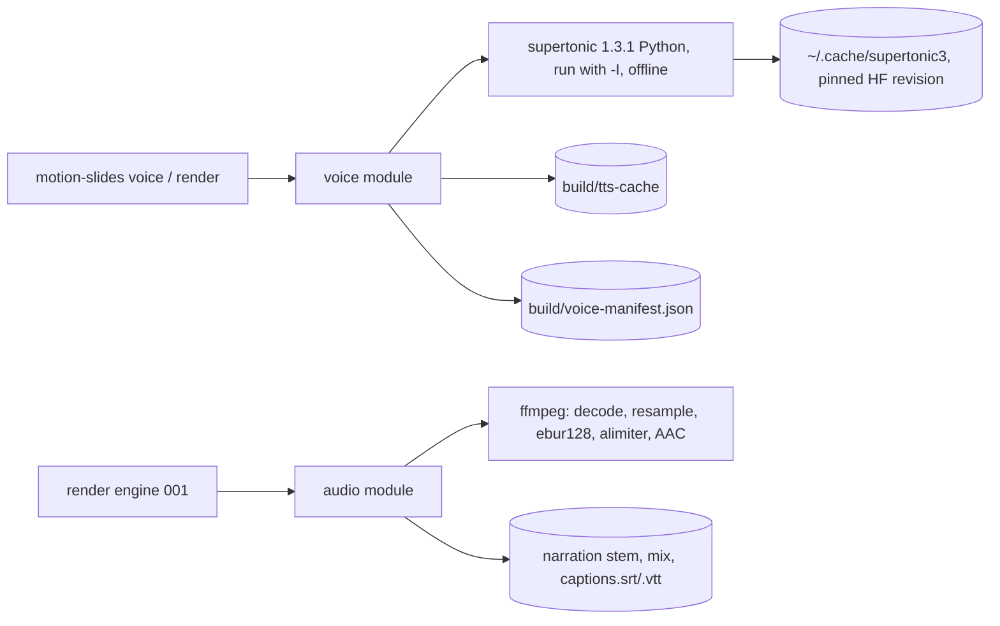

# Design: Local narration and audio

Build-plan Stage 2. The listening pack (US8) comes after the PoC.

## Context

## Approach

- **Speech text.** The spoken text is computed in Node, by a pure function:
  - Override precedence: `speak_supertonic`, then `speak`, then the caption.
  - The caption then goes through the pronunciation map (default map, then the idea's map, then a
    private map passed by path). Replacement is one pass, longest key first, whole word, case
    sensitive.
  - Numbers are then turned into words.
  - The result is checked for leftover digits or the symbols `$ % & # @ / +`.
- **Synthesis.**
  - One Python helper process (`src/voice/synth.py`) runs under the supertonic tool's own interpreter:
    `-I`, `HF_HUB_OFFLINE=1`, `HF_HUB_DISABLE_TELEMETRY=1`, and an environment with no proxy variables.
  - It checks the model files with `has_all_onnx_modules` first and exits with code 3 ("voice weights
    missing") if they are absent.
  - It builds `TTS(model='supertonic-3', auto_download=False, intra_op_num_threads=4)` once, loads style
    `M3`, and for each request calls `np.random.seed(1234)` and then
    `synthesize(text, style, total_steps=32, speed=0.75, lang='en')`.
  - It writes a float32 WAV per line and reports one JSON line per item on stdout.
- **Clip processing in Node.**
  - ffmpeg decodes each clip to 48 kHz mono f32.
  - Node trims to the first and last sample above -50 dBFS, keeping 0.02 s before and 0.06 s after, and
    stores the clip as `build/tts-cache/<sha256>.wav` with a sidecar holding the sample count and PCM
    hash.
  - The cache key is the SHA-256 of a canonical JSON of the spoken text, engine and version, model, model
    revision, voice, lang, steps, speed, seed, trim settings and sample rate.
- **Mix.** Node builds everything in memory at 48 kHz, so placement is exact to one sample (AC9.1):
  - the narration stem: zeros the length of the video, each clip added at `round(start*48000)`;
  - the pad: a deterministic generated chord (sum of low sines with a slow fade), peak-normalised, times
    `pad_volume`;
  - the mix: narration plus pad.
  Loudness:
  - ffmpeg `ebur128=peak=true` measures integrated loudness, and Node applies the gain to reach -16 LUFS.
  - ffmpeg `alimiter` (limit -2.5 dBFS, `asc` off, `level` off) limits the peaks.
  - It is then re-measured, with up to two gain corrections inside ±0.5 LU.
  - After the 001 encode, the AAC track in the final MP4 is measured again. If it misses -16 ±0.5 LUFS or
    has a true peak above -1.5 dBTP, the render fails with the numbers (AC9.5).
- **Why.** Node-side PCM keeps placement exact and deterministic. ffmpeg's `loudnorm` in dynamic mode is
  not sample-stable across versions, so gain plus limiter is simpler to reason about and to test.

## Modules

| Module | Interface | Hides | New / changed |
|--------|-----------|-------|---------------|
| `voice/settings` | `checkVoiceSettings(idea): IdeaError[]` | binding values, `say` licence message, lang | new (plugs into 001 `loadIdea`) |
| `voice/spoken` | `spokenText(beat, maps): Result<string, SpokenError>` | override precedence, map compile (escaped alternation, longest first, Unicode word boundaries), numbers to words, ambiguous tokens, leftover check | new |
| `voice/numbers` | `numberToWords(token): string \| null` | integers, decimals, thousands separators, `$` amounts with cents, percentages | new |
| `voice/pass` | `voicePass(folder, {privateMap?, signal}): Promise<VoiceReport>` | lock, cache lookup and repair, Python batch, trim and resample, manifest write, review lists (all-caps tokens, 130 to 180 wpm), script sheet | new |
| `voice/python` | `resolveVoicePython(idea): string`, `runSynth(items, signal)` | interpreter resolution (idea, install record, default uv tool path), weights check, JSON-lines protocol, exit-code mapping | new |
| `audio/mix` | `mixAudio(schedule, manifest, cfg): Promise<{stemPath, mixPath, measured}>` | stem placement, pad, ebur128 measure, gain, alimiter, re-measure | new |
| `audio/captions` | `writeCaptionFiles(schedule, idea, outDir)` | SRT and VTT timing to the millisecond, escaping, VTT NOTE with the disclosure | new |

## Data model

- `build/voice-manifest.json` (stable order):
  - `version`, `engine: {name, version, model, revision}`, `settings_hash`;
  - `beats[{scene, beat, caption, spoken, key, clip, length, onset, end, wpm}]`;
  - `totals: {clips, synthesised, cached, speech_seconds, estimated_duration, cap}`;
  - `review: {unmapped_caps[], off_rate[]}`.
- `build/tts-cache/<key>.wav` plus `<key>.json` with `{samples, pcm_sha256}`.
- `build/narration.wav` (the stem), `build/mix.wav`, and `build/audio-measure.json`.

## Contracts

- `motion-slides voice [folder] [--private-map <path>] [--json]`.
- Exit codes: 0 ok, 1 failure, 3 "voice weights missing". The message prints
  `scripts/install.sh --with-voice-weights`.
- 001 `render` (non-preview) requires a manifest that matches the idea (AC3.3). It calls `mixAudio`
  before the encode.

## Cross-cutting concerns

- **Security.**
  - The Python helper gets its input over stdin as JSON and runs with `-I`, so nothing from the video
    folder is on its import path.
  - Arguments are passed as arrays, never through a shell.
  - The private map is read-only, and its content is never logged. Logs name the map file by base name
    only.
- **Offline and consent.**
  - `auto_download=False` plus `HF_HUB_OFFLINE=1`, and the weights are checked before load.
  - No code path mentions Ollama.
  - Only `scripts/install.sh --with-voice-weights` downloads. It prints the size (about 0.4 GB), the
    destination and the licence (OpenRAIL-M), then uses the package's own `download_model`. That
    function downloads to a temp folder and moves it into place only when complete.
- **Failure modes.**
  - If the Python process crashes mid-batch, clips finished before the crash are already in the cache,
    and a re-run synthesises only the rest.
  - A clip that is corrupt or fails its PCM hash is discarded and synthesised again, and this is logged.
- **Performance.** A 180 s script must voice in under 5 minutes from an empty cache. That is measured
  once the weights are present.

## Testing strategy

- **Unit tests:**
  - map ordering, whole-word matching, no recursion;
  - numbers (table-driven), ambiguous tokens, the leftover check;
  - settings rejection messages;
  - SRT and VTT golden files with `<`, `&`, `-->`;
  - cache key stability;
  - trim against synthetic PCM.
- **Integration tests (no weights):**
  - The mix is fed tone-burst "clips" generated at test time. Asserts: placement to one sample, the pad
    gain, -16 ±0.5 LUFS and true peak ≤ -1.5 dBTP measured on the encoded AAC, and two runs giving
    sample-identical audio.
  - A fake Python that exits with code 3 gives the "voice weights missing" path.
- **Voice suite (`npm run test:voice`):** runs only where the weights exist and reports NOT RUN
  otherwise. Asserts:
  - the same line twice with the cache cleared gives a sample-identical clip;
  - the second pass reports "0 synthesised, N cached";
  - one changed line means one synthesis.

## Alternatives considered

| Option | Why not |
|--------|---------|
| ffmpeg `loudnorm` two-pass | Fine in linear mode, but falls back to dynamic mode silently when the peak target is not reachable; explicit gain plus limiter is easier to test |
| `adelay` + `amix` in ffmpeg for placement | amix normalisation and rounding make one-sample accuracy harder to prove |
| Supertonic CLI per line | Loads the model per line; one batch process is required (AC3.1) |

## Constitution check

| Principle | Pass? | Note |
|-----------|-------|------|
| P1 Local voice only | yes | only supertonic, binding settings enforced, no cloning input |
| P2 No model pulls without yes | yes | auto_download off, offline env, installer consent flag |
| P3 Brief is the source of truth | yes | spoken text derived from the idea; overrides come from the brief |
| P4 Cut pauses, never content | yes | voice speed fixed at 0.75 |
| P6 No company content in repo | yes | private maps by path only, never copied |
| P7 Honest reporting | yes | loudness failure reported with numbers; listening check NOT VERIFIED until a human records it |
