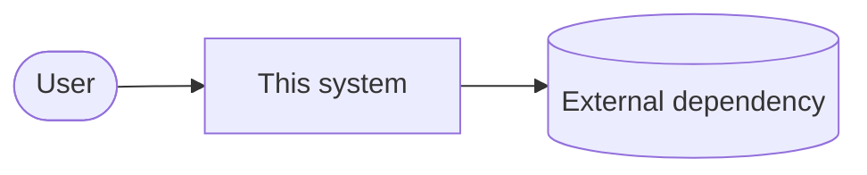
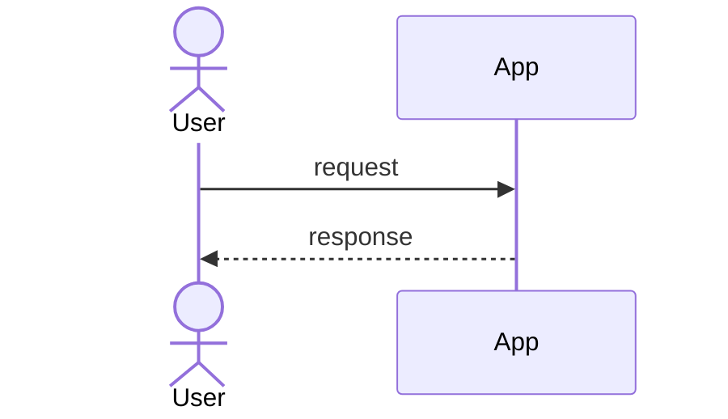

# Design: Local narration and audio

<!--
DevBox design. Describes HOW, at the level of modules, interfaces, data and risks.
Every section should be short. Delete sections that genuinely do not apply, and say why in one line.
Patch-lane work can delete this file entirely.
-->

## Context

Where this sits in the system (C4 level 1 or 2). Keep the diagram to the boxes that matter.

## Approach

The chosen approach in a few sentences, and why it beats the alternatives below.

## Modules

Prefer deep modules: small, stable interfaces hiding real complexity. Name each module,
its public interface, and what it hides. These interfaces are where the tests go.

| Module | Interface (public surface) | Hides | New / changed |
|--------|----------------------------|-------|---------------|
|        |                            |       |               |

## Data model

Entities, fields, invariants, ownership. Note migrations and whether they are backward compatible
(expand, migrate, contract).

## Contracts

APIs, events, CLI flags, file formats, or function signatures other code will depend on.
Link machine-readable contracts (OpenAPI, JSON Schema, protobuf) in `contracts/` if they exist.

## Key flows

## Cross-cutting concerns

- **Security (STRIDE):** spoofing, tampering, repudiation, information disclosure, denial of service,
  elevation of privilege. List only the threats that apply and the mitigation for each.
- **Privacy:** what personal data is touched, where it is stored, retention.
- **Observability:** logs (structured, no secrets), metrics (RED or USE), traces, alerts, SLO impact.
- **Performance budget:** latency, memory, bundle size, cost, whichever applies.
- **Failure modes:** what happens when each dependency fails; timeouts, retries, idempotency.
- **Rollout and rollback:** feature flag, migration order, how to undo in under 5 minutes.

## Testing strategy

Which behaviors are tested at which level (unit, integration, contract, end-to-end), what is
mocked (system boundaries only), and which acceptance criteria are proven by which tests.

## Alternatives considered

| Option | Why not |
|--------|---------|
|        |         |

## Decisions

ADRs created for this feature (`devbox adr "<title>"`): link them here.

## Constitution check

| Principle (.devbox/constitution.md) | Pass? | Note / justified exception |
|-------------------------------------|-------|----------------------------|
|                                     |       |                            |
