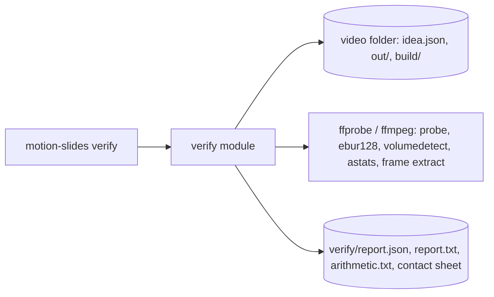

# Design: Verify gate

Build-plan Stage 3.

## Context

## Approach

- The gate is a list of independent check functions. Each has the signature
  `(ctx) => Promise<CheckResult>`, where
  `CheckResult = {id, title, status: 'VERIFIED'|'NOT VERIFIED', measured, threshold, method, details[]}`.
- `ctx` is built once per run, fresh every time (AC9.5). It holds:
  - the parsed idea and the schedule;
  - the ffprobe JSON of the MP4;
  - the decoded MP4 audio and the narration stem, both read as 48 kHz f32 arrays through ffmpeg;
  - the `captions.jsonl` and `stage-text.jsonl` written at capture (001);
  - the caption files;
  - the SHA-256 of every output.
  A missing input marks the checks that need it NOT VERIFIED, naming the input (AC12.2).
- Measurements:
  - Loudness and true peak: `ffmpeg -af ebur128=peak=true` on the final MP4.
  - Mean volume: `volumedetect`.
  - Per-beat level, onsets and silences: computed in Node from the decoded PCM. This is exact and needs
    no parsing of ffmpeg logs, which keeps it testable.
- Caption fade checks use the per-frame opacities recorded during capture. The frame count must match
  the MP4's `nb_frames` (AC5.3).
- On-screen text (banned terms, figures) uses `stage-text.jsonl`: the visible stage text at each beat's
  settle time and at each counter landing, recorded by the capture.
- Contact sheet: ffmpeg extracts the chosen frames from the final MP4. Labels come from ffmpeg `drawtext`
  with the bundled font file, and `tile` builds the sheet: 4 columns, at most 19 frames per sheet.
- Exit 0 only if every automated check is VERIFIED. Manual checks are listed separately and do not
  change the exit code (AC9.3).

## Modules

| Module | Interface | Hides | New / changed |
|--------|-----------|-------|---------------|
| `verify/gate` | `verifyFolder(folder, {privateTerms?, copies?, signal}): Promise<Report>` | context loading, check list, report writing, exit status | new |
| `verify/checks/*` | one file per story: `format`, `loudness`, `silence`, `sync`, `fades`, `banned`, `arithmetic`, `checksums`, `disclosure` | measurement and thresholds | new |
| `verify/pcm` | `decodePcm(path): Float32Array`, `rmsDb(pcm, from, to)`, `onsetAfter(pcm, t, thrDb)`, `silences(pcm, thrDb, minSec)` | ffmpeg decode, windowed math | new |
| `verify/figures` | `evaluateFigures(table): {name, formula, computed, stated, ok}[]`, `formatFigure(fig)` | safe expression parser (numbers, names, + - * / and parentheses only; no eval) and display formats | new (shared with 004 and 005) |
| `verify/contact` | `contactSheet(mp4, moments, outDir)` | moment selection (AC10.1 to AC10.3), extraction, labels, tiling | new |

## Data model

- `verify/report.json`:
  - `{version, mp4: {path, sha256}, outputs: {name: sha256}, checks: CheckResult[], manual:
    [{id, status, by?, date?, tied_to}], verified: boolean}`.
- `verify/report.txt` is the same report in human-readable form.
- `verify/arithmetic.txt` has one line per figure.
- `verify/frames/*.png` holds the extracted frames, and `verify/contact-sheet-<n>.png` the sheets.
- Manual verdicts go in `verify/manual.json`, written by `verify --record <check> --by <name>` and tied to
  the MP4's SHA-256 (AC10.5).

## Cross-cutting concerns

- **Security.**
  - Figures formulas are parsed by a small recursive-descent parser, never `eval` or `Function`.
  - Private banned terms are reported as `private term #n`. The term text never reaches stdout, the
    report or the logs (AC6.3).
  - A missing or empty private list fails the check (AC6.4).
- **Honesty.** There is no warn-only mode. Every failure carries the measured value and the threshold.
- **Performance.** Verifying a 180 s video should take under 60 s. Decoding to PCM once and doing the
  analysis in Node keeps it linear in the audio length.

## Testing strategy

- Each check has an integration test with a planted defect that must make it fail, plus one clean
  fixture that passes everything:
  - a 2.5 s silence;
  - a caption cue 0.2 s early;
  - a mix 3 dB too hot;
  - a peak above -1.5 dBTP;
  - two overlapping captions in `captions.jsonl`;
  - a banned word in a caption;
  - a private term (its text absent from the output);
  - a wrong total in the figures table;
  - a preview MP4;
  - a missing stem;
  - a changed copy.
- Fixtures are built by the real 001 and 002 pipeline from tone clips, then altered.
- Unit tests cover the figures parser, onset and silence math, and moment selection.

## Alternatives considered

| Option | Why not |
|--------|---------|
| Parse ffmpeg `silencedetect` logs for silences and onsets | Log format parsing is brittle; PCM math in Node is exact and unit-testable. ffmpeg still does the standardised loudness measurement |
| Re-detect captions from decoded frames (OCR or pixel diff) | Needs a model or heavy image work; the capture records each frame's caption opacity, and AC5.3 ties that record to the MP4's frame count |

## Constitution check

| Principle | Pass? | Note |
|-----------|-------|------|
| V Evidence over assertion | yes | every check reports measured value, threshold, method |
| P6 No company content | yes | private terms never printed |
| P7 Honest reporting | yes | VERIFIED / NOT VERIFIED only, manual checks separate, no warn-only mode |
