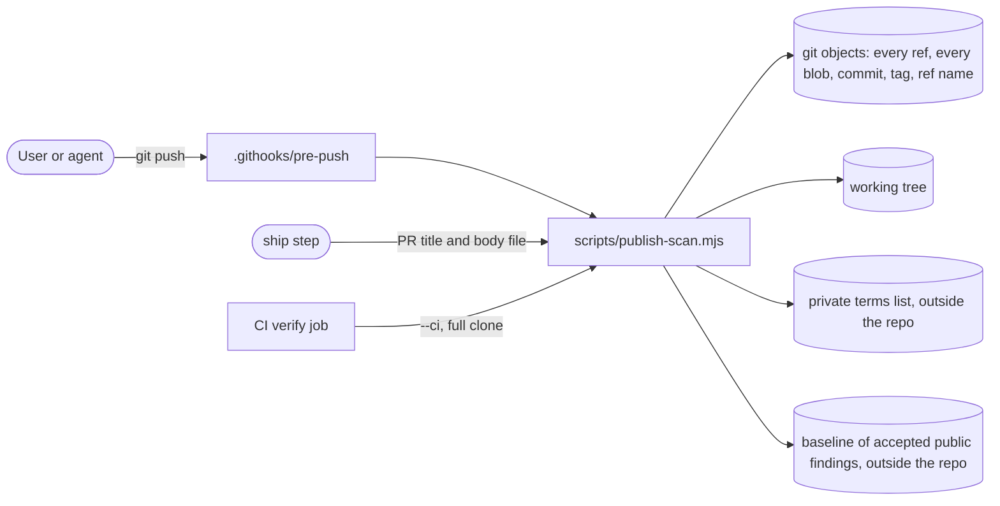

# Design: Acceptance and public release

This file designs Slice 1, the publish-safety scan (US4), which ships in build-plan Stage 0 because the
repository is already public. The acceptance runs, README, licence, notices and release (US1 to US3,
US5) are designed in Stage 8, after features 001 to 007 ship.

## Context

## Approach

- One dependency-free Node script, `scripts/publish-scan.mjs`, so it runs before `npm ci` and in the
  hook without the package being installed. Its logic lives in `scripts/publish-scan/lib.mjs` so tests
  call it directly.
- **Modes.**

  | Mode | Used by | Rules | Scope |
  |------|---------|-------|-------|
  | full (default) | pre-push hook, ship step, `devbox verify` evidence | secrets, private terms, host identity | working tree and full history |
  | `--ci` | CI verify job | secrets only (CI has no private list and is not this box) | working tree and full history |
  | `--text <file>` | ship step, before `gh pr create --body-file` | secrets, private terms, host identity | that one file |

- **Fail closed.** Exit 0 clean, 1 findings, 2 cannot scan. Exit 2 when: the private terms list is
  missing, unreadable or has no terms (full and text modes); the clone is shallow
  (`git rev-parse --is-shallow-repository` is true); git fails; or, in full mode, the installed hook is
  not exactly right (see Hook installation), so a clone where pushes would go unscanned cannot pass the
  ship scan.
- **Inputs.**
  - Private terms: `$HOME/.config/motion-slides/private-terms.txt`. No product variable points the scan
    at a different list. `HOME` does decide the folder, and tests use that to plant a list in a
    temporary folder; running a real push with a different `HOME` on purpose is a deliberate bypass of
    the same kind as `--no-verify`, which AGENTS.md already bans. One term per line. A line whose first
    character after optional spaces is `#` is a comment; a `#` anywhere else is part of the term, so a
    term may contain `#`. Matching is case-insensitive:
    - terms of 5 or more characters match as substrings (they catch `AcmeBrief.md`, `acme_q3.json`
      and `acmeColors`);
    - shorter terms match unless the character before is a letter or the character after is a
      lowercase letter, with two exceptions: a lowercase letter before a match whose first character is
      uppercase still counts (camelCase, as in `myQrx` or `myQRX`), and a single `s` after an all-caps
      match still counts (`QRXs`). So `QRX_notes`, `QRXColors`, `myQRX`, `myQrx` and `Kim's` match,
      while `Kimberly` does not. Substring matching for short terms is ruled out: one 3-character term hit
      143 ordinary words in a test corpus.
    - In binary content (a blob or file with a NUL byte in its first 8 KB) the camelCase exception is
      off, because glyph and table data produce letter runs that look like camelCase (the bundled font
      had six such hits for one short term, all through that exception). Every other rule applies.
  - Host identity, computed at run time: the host name and its short form, the user name and home
    folder from the password database (`os.userInfo()`, so a changed `HOME` does not hide them) and
    from `HOME`, and every non-loopback, non-link-local IP address of this box. The user name matches
    as a short term above; the home path as a substring. Tests may add facts through
    `MOTION_SLIDES_SCAN_EXTRA_FACTS` (JSON); the variable only adds facts and never removes the real
    ones, so it cannot silence the scan.
  - Baseline: `$HOME/.config/motion-slides/publish-scan-baseline.txt`, one fingerprint per line. Only
    the user edits it. Agents never write it.
  - Fingerprint key: `$HOME/.config/motion-slides/publish-scan.key`, 32 random bytes created with mode
    0600 on first use.
  - Allowed binaries: `$HOME/.config/motion-slides/allowed-binaries.txt`, one line per file content
    with its SHA-256, path and reason. Only the user edits it, after looking at the file and before the
    push that would publish it; agents never write it. It lives outside the repository because a branch
    is public as soon as it is pushed, before any PR exists. A listed SHA-256 clears any blob in history
    and any working-tree file with that exact content, opaque or not, from every rule. The product
    avoids opaque binaries where it can (the bundled font is the uncompressed TrueType file).
- **Scope of a full or CI scan.**
  - Working tree: `git ls-files -z --cached --others --exclude-standard`, read as bytes.
  - History: every object reachable from any ref, plus every commit being pushed, from
    `git rev-list --objects --all <pushed ids>`, read with one `git cat-file --batch` process and
    deduplicated by object id. The hook passes the local object ids git hands it on standard input as
    `--include <id>` arguments, so a commit no branch reaches (`git push origin <id>:refs/heads/x`) is
    still scanned.
    - Every git command of the scan runs with `GIT_NO_REPLACE_OBJECTS=1`. A replacement object
      (`git replace`) makes git show a stand-in wherever it reads the replaced object, while a push still
      sends the original. The replacements stay in scope: their `refs/replace/*` refs are refs like any
      other.
    - Blobs are scanned as bytes decoded as latin1, so binary files are covered too. A blob with a
      UTF-16 byte-order mark, or with NUL in every other byte of its first 1 KB, is also decoded as
      UTF-16.
    - Opaque containers cannot be read by a byte scan, so in full mode a blob whose first bytes mark
      one (zip and Office files, PDF, gzip, bzip2, xz, zstd, 7z, WOFF and WOFF2, or a PNG with `zTXt`
      or `iTXt` chunks) is a finding unless its SHA-256 is in the user's allowed-binaries file. `--ci`
      mode does not apply this rule (CI has no user file and checks secrets only).
    - Tree entry names (paths) are scanned.
    - Commits and annotated tags are scanned raw: every header (for commits that includes `author`,
      `committer`, `encoding`, `mergetag` and any header git does not write itself) and the full
      message. A header's continuation lines are unfolded, so a `mergetag` (a whole tag object inside
      a merge commit) is scanned too. Only text nobody wrote is left out:
      - genuine signature armour: a `-----BEGIN PGP SIGNATURE-----` or `-----BEGIN SSH SIGNATURE-----`
        line, its matching `-----END ... -----` line, and the lines between, when every one of those is
        base64 (with `=` padding and the `=` CRC line), blank, or a `Version:` or `Comment:` armour
        header. Random base64 would trip short terms. The armour headers are written text and are
        still scanned. The same rule applies inside the continuation lines of `gpgsig` and `mergetag`
        headers. A BEGIN line followed by anything else (ordinary text, a missing END) is ordinary text,
        scanned with what follows it, so a fake signature line hides nothing. Known limit: text made
        only of base64 characters inside a block of the genuine shape is not scanned.
      - lines that are exactly `tree`, `parent` or `object` and an object id, whose hex digits would
        trip short terms.
  - Ref names: `git for-each-ref --format=%(refname)` (branches, tags, remotes, stash).
- **Secret rules** (all modes): GitHub tokens (`gh[pousr]_` + 36 or more, `github_pat_`), AWS access
  keys (`AKIA` + 16), PEM private keys, Slack tokens (`xox[abprs]-`), Google API keys (`AIza` + 35),
  OpenAI (`sk-`, `sk-proj-`), Anthropic (`sk-ant-`) and Hugging Face (`hf_`) keys.
- **Output never contains a matched value.** One line per finding: rule id, location and fingerprint.
  - Locations: `worktree <path>:<line>`, `blob <oid> <path>`, `tree <oid> <path>`,
    `commit <oid> <header>|message` (a header git does not write itself prints as `header`),
    `tag <oid>`, `ref <name>`, `pushed-ref <name>`, `text <file>:<line>`. Before printing, every match inside a printed
    path or ref name is replaced by its label, so a term in a file or branch name is never echoed.
  - Labels: `<private term #n>` (list position), `<host name>`, `<user name>`, `<home path>`,
    `<ip address>`, `<secret:rule>`.
  - The fingerprint is the first 16 hex digits of HMAC-SHA256 under the local fingerprint key, over the
    rule id, the object id (or ref name) and the matched term's text. It cannot be reversed without the
    key, and reordering the list does not move an accepted fingerprint to a different term.
  - Evidence that gets committed or posted (progress.md, PR bodies) is the summary line only:
    `publish-scan: <mode>, <objects> objects, <refs> refs, <n> findings`.
- **Already published (AC4.5).** GitHub keeps pull-request refs, so any finding in history is treated as
  possibly public.
  - A history finding not in the baseline prints `IN HISTORY: if this commit was never pushed, amend it;
    if it was, stop and ask the user before any history rewrite (AC4.5)` and exits 1.
  - A finding whose fingerprint is in the baseline prints `accepted by the user (baseline)` and does not
    fail.
  - Working-tree and text findings are never baselined.
- **Hook installation.** An absolute `core.hooksPath` goes stale when the clone is moved or renamed, and
  git then runs no hook and says nothing. A relative one makes git look for the hook inside whichever
  checkout is pushing, and a checkout of an older commit has no hook file. A hook file without the
  executable bit is skipped by git with only a hint. So `core.hooksPath` is not used:
  - `package.json` has `"prepare": "node scripts/install-hooks.mjs"`. Inside a git work tree it copies
    `.githooks/pre-push` to `<git common dir>/hooks/pre-push`, git's default hooks folder, with mode
    0755. That folder moves with the clone and is shared by every worktree and branch. It also removes
    a local `core.hooksPath` if one is set, and deletes `<git common dir>/motion-slides-hooks`, the
    folder an earlier version pointed `core.hooksPath` at, so old clones migrate on the next `npm ci`.
    Outside a git work tree it does nothing.
  - The hook reads its standard input first. When every line is a deletion (an all-zero local id), it
    exits 0 without scanning: deleting a remote ref publishes nothing, and this keeps a badly named
    branch deletable. Otherwise it runs `node scripts/publish-scan.mjs --include <id>...
    --push-ref <ref>...` from the pushing checkout, with the local object ids and the remote ref names
    of the lines that are not deletions. A remote ref name becomes public with the push, so it is
    scanned before it exists (location `pushed-ref`), and it is never baselined. It exits 1 (push
    blocked, with a message) if the scanner file does not exist, so a push from a checkout older than
    the scanner is refused instead of skipped.
  - Full mode checks that `git rev-parse --git-path hooks` resolves to `<git common dir>/hooks` (so no
    `core.hooksPath`, local or global, sends hooks elsewhere), and that `pre-push` exists there, is
    executable, and is byte-identical to `.githooks/pre-push`. Any mismatch is exit 2, with a message
    to run `node scripts/install-hooks.mjs`.
- **CI.** Checkout uses `fetch-depth: 0` and `persist-credentials: false`. The `verify` job runs
  `node scripts/publish-scan.mjs --ci` straight after checkout and Node setup, before `npm ci` runs any
  install script, then `devbox verify`. Finding lines carry no matched values, so the public CI log
  leaks nothing.
- **Text posted to GitHub.** Neither the hook nor CI sees PR titles, bodies or comments, and test output
  pasted as evidence carries absolute paths (vitest prints the project root on its first line). So:
  - AGENTS.md gets an "Always" rule: before any `gh pr create|edit|comment` or
    `gh issue create|edit|comment`, write the title and body to a temporary file, run
    `node scripts/publish-scan.mjs --text <file>`, and post with `--body-file` only on exit 0.
  - AGENTS.md also says that evidence pasted into PR bodies and `progress.md` is summary lines only
    (pass and fail counts, gate names), never raw tool output with paths.

## Modules

| Module | Interface | Hides | New / changed |
|--------|-----------|-------|---------------|
| `scripts/publish-scan/lib.mjs` | `scan({mode, repo, textFile?, include?, pushRefs?, env}): Promise<{code, findings}>` | git object enumeration, batch reading, rules, host facts, baseline, published-object set, fingerprints, output formatting | new |
| `scripts/publish-scan.mjs` | CLI: `[--ci] [--text <file>] [--include <id>]... [--push-ref <ref>]...` | argument parsing (an `--include` value that is not 40 or 64 lowercase hex digits, or a `--push-ref` value that is not a `refs/` name without whitespace or control characters, is exit 2), exit codes | new |
| `scripts/install-hooks.mjs` | run by `prepare` | work-tree detection, copy to `<git common dir>/hooks` with mode 0755, removal of a local `core.hooksPath` and of the old hooks folder | new |
| `.githooks/pre-push` | git hook source (installed copy runs) | lets a deletion-only push through unscanned; refuses the push when the pushing checkout has no scanner | new |

## Security

- **Information disclosure** is the threat. The scan prints no matched value, terms only by position,
  and is safe to run in a public CI log.
- **Fails closed** on every missing input (Article VI).
- **Tampering.** The terms list, baseline, allowed binaries and fingerprint key all live outside the
  repository, so no commit or branch can weaken the scan's inputs, and no binary is allowed before the
  user has looked at it. The test seam only adds facts. Known limit: the hook and CI run the scanner
  code of the branch being pushed, so a branch that edits `scripts/publish-scan*` could weaken its own
  check. AGENTS.md lists changes to those files as ask-first, and the PR diff shows them.
- **Limits.** Regexes have no nested quantifiers. Blobs are scanned in a single pass per rule set.

## Testing strategy

- Integration tests (`test/integration/publish-scan.test.ts`) build temporary git repositories under
  `os.tmpdir()` with real git. Every planted secret, term and host fact is assembled at run time
  (for example `'gh' + 'p_' + 'A'.repeat(36)`) and never appears literally in the source.
- Cases, each asserting the exit code, the finding line, and that neither stdout nor stderr contains
  the planted value:
  - a secret in a blob deleted by a later commit;
  - a secret inside a binary file, and a term inside a UTF-16 file;
  - a non-opaque binary file with a short-term hit is flagged in the working tree and in history, and
    passes once its hash is in the user's allowed-binaries file; a binary with a lowercase letter before
    an uppercase-start short term is not flagged, while the same shape in a text file (`myQrx`) is;
  - an `--include` value that is not an object id is refused with exit 2;
  - a zip file and a PDF are flagged as opaque in full mode; a zip whose hash is only listed inside the
    repository is still flagged; it passes once its hash is in the user's allowed-binaries file
    (planted through `HOME`); `--ci` does not flag it;
  - a commit that no branch reaches, pushed by id to a new remote branch with a planted term, is
    blocked by the installed hook;
  - a private term in a file, a path, a commit message, an author name, a branch name and an annotated
    tag message, each reported as `<private term #n>` with the term absent from the printed path or
    ref;
  - a term in the `mergetag` header of a merge commit (built with `git hash-object`) blocks the push,
    while genuine armour in its `gpgsig` and inside the merged tag is skipped; a tag message with a fake
    BEGIN line followed by a term and a secret is flagged in full and in `--ci`;
  - the short-term table: `QRX_notes`, `QRXColors`, `myQRX`, `QRXs` and `Kim's` match, `Kimberly` does not
    (with planted stand-ins of the same shapes); a 5-character term matches inside `xTermx`;
  - an extra host fact in a file;
  - a missing list, an empty list and an unreadable list (exit 2);
  - a shallow clone in `--ci` (exit 2);
  - full mode with no hook installed, a local or a global `core.hooksPath` pointing elsewhere, a hook
    with mode 0644, and a hook whose bytes differ (each exit 2); the installer migrates a clone off the
    old `motion-slides-hooks` folder;
  - a history finding prints IN HISTORY; the same finding with its fingerprint in a temporary baseline
    passes; the fingerprint changes when the key changes;
  - `--text` on a PR body with a term and one with an absolute home path;
  - after running `scripts/install-hooks.mjs` in a temporary clone, a real `git push` to a temporary
    bare remote is blocked when a term is planted and allowed when clean, and a push from a branch cut
    before the scanner existed is blocked by the installed hook; the same holds after the clone is moved
    to another folder and from a linked worktree; a deletion-only push of a badly named branch passes.
- Repository check: `node scripts/publish-scan.mjs` exits 0 on this repository's full history with the
  real private list. The output goes in progress.md; it runs locally only, because CI has no list.

## Constitution check

| Principle | Pass? | Note |
|-----------|-------|------|
| VI Secure by default | yes | fails closed, no values printed |
| IX Humans own the irreversible | yes | already-public findings stop and ask; only the user edits the baseline |
| P6 No company content in repo | yes | every push, every object, every ref |
| IV Simplicity | yes | no dependencies, plain git plumbing |
